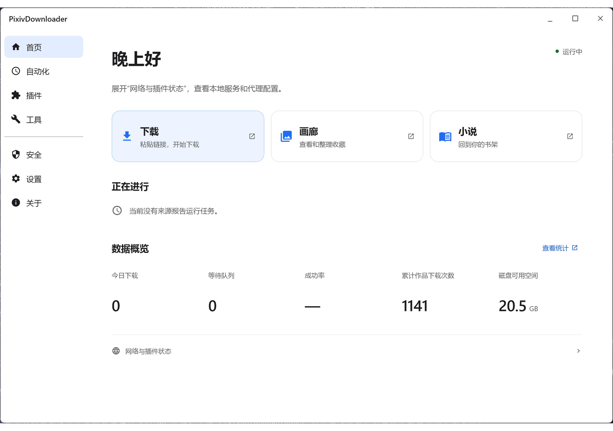

# PixivDownloader

中文 | [繁體中文](./README_zh-Hant.md) | [日本語](./README_ja.md) | [한국어](./README_ko.md) | [English](./README_en.md)

PixivDownloader 是本地运行的 Pixiv 插画、漫画、动图（Ugoira）与小说批量下载及本地画廊管理工具，支持桌面界面（Compose / Swing）、浏览器下载工作台与 Tampermonkey 脚本。

## 核心功能

- **多方式获取与批量下载**：支持[快捷获取](https://sywyar.github.io/PixivDownloader/#/zh-cn/quick-access)（收藏、投稿、约稿、关注新作、珍藏集）、[URL 批量导入](https://sywyar.github.io/PixivDownloader/#/zh-cn/batch-download)、[画师批量下载](https://sywyar.github.io/PixivDownloader/#/zh-cn/user-download)、[关键词搜索下载](https://sywyar.github.io/PixivDownloader/#/zh-cn/search)、漫画/小说系列下载与 [Tampermonkey 油猴脚本](https://sywyar.github.io/PixivDownloader/#/zh-cn/userscripts)。
- **媒体转码与小说能力**：图片支持原始格式、PNG、JPG、WebP 多选保存；动图支持转码为 WebP、GIF、APNG、MP4 或保留原始 ZIP；[小说](https://sywyar.github.io/PixivDownloader/#/zh-cn/novel)支持保存为 TXT / HTML / EPUB（含系列合订本）、正文全文检索、AI / 有道 / LibreTranslate 翻译与 AI 多角色朗读。
- **本地画廊与整理工具**：[作品画廊](https://sywyar.github.io/PixivDownloader/#/zh-cn/gallery)与小说画廊支持多条件筛选、三态标签/作者组合、本地收藏夹、批量 ZIP 导出、统计看板、基于感知哈希（dHash）的疑似重复检测及只读访客邀请码。
- **计划任务与通知**：[计划任务](https://sywyar.github.io/PixivDownloader/#/zh-cn/scheduled-tasks)支持固定周期或 6 位 Cron 后台增量追更，遇到登录态失效、过度访问警告或连续失败熔断时通过邮件与多通道推送告警。
- **插件化与可扩展界面**：默认提供 Compose 与 Swing 桌面界面、SQLite 与可选 PostgreSQL 数据库支持、[插件管理与市场](https://sywyar.github.io/PixivDownloader/#/zh-cn/plugin-management)、[页面编辑器](https://sywyar.github.io/PixivDownloader/#/zh-cn/page-editor)、[操作验证码](https://sywyar.github.io/PixivDownloader/#/zh-cn/captcha)、[PixivBatchDownloader 导入支持](https://sywyar.github.io/PixivDownloader/#/zh-cn/pixiv-batch-downloader-import)及公开 [第三方插件 SDK](https://sywyar.github.io/PixivDownloader/#/zh-cn/plugin-development)。

## 界面预览

> 少许截图设备启用了 HDR，颜色效果可能不同；以下为简体中文界面截图（点击动图查看完整静态截图）。

- [浅色模式使用截图](./readme/zh-CN/md/light-screenshot.md) · [暗色模式使用截图](./readme/zh-CN/md/dark-screenshot.md)

## 快速开始

### 1. 下载发行包

从 [Releases](../../releases) 下载最新版，按该版本发行说明中的表格选择适合的发行包。

### 2. 启动与初始化

按照[安装与启动](https://sywyar.github.io/PixivDownloader/#/zh-cn/installation)运行程序，再依照[首次配置](https://sywyar.github.io/PixivDownloader/#/zh-cn/first-setup)完成初始化。

## 在线文档

完整配置、迁移、排障与开发参考请查阅[在线文档](https://sywyar.github.io/PixivDownloader/#/zh-cn/)：

- **开始使用**：[安装与启动](https://sywyar.github.io/PixivDownloader/#/zh-cn/installation) · [首次配置](https://sywyar.github.io/PixivDownloader/#/zh-cn/first-setup) · [第一次下载](https://sywyar.github.io/PixivDownloader/#/zh-cn/first-download)
- **取得与下载**：[快捷获取](https://sywyar.github.io/PixivDownloader/#/zh-cn/quick-access) · [URL 批量下载](https://sywyar.github.io/PixivDownloader/#/zh-cn/batch-download) · [画师批量下载](https://sywyar.github.io/PixivDownloader/#/zh-cn/user-download) · [搜索下载](https://sywyar.github.io/PixivDownloader/#/zh-cn/search) · [小说与朗读](https://sywyar.github.io/PixivDownloader/#/zh-cn/novel) · [计划任务](https://sywyar.github.io/PixivDownloader/#/zh-cn/scheduled-tasks) · [油猴脚本](https://sywyar.github.io/PixivDownloader/#/zh-cn/userscripts) · [导入外部下载](https://sywyar.github.io/PixivDownloader/#/zh-cn/pixiv-batch-downloader-import)
- **管理与排障**：[作品画廊](https://sywyar.github.io/PixivDownloader/#/zh-cn/gallery) · [配置参考](https://sywyar.github.io/PixivDownloader/#/zh-cn/configuration) · [存储与备份](https://sywyar.github.io/PixivDownloader/#/zh-cn/storage) · [CLI 与进阶参考](https://sywyar.github.io/PixivDownloader/#/zh-cn/usage-guide) · [网络访问与第三方服务](https://sywyar.github.io/PixivDownloader/#/zh-cn/network-access) · [常见问题](https://sywyar.github.io/PixivDownloader/#/zh-cn/faq)
- **插件与开发**：[插件管理](https://sywyar.github.io/PixivDownloader/#/zh-cn/plugin-management) · [页面编辑器](https://sywyar.github.io/PixivDownloader/#/zh-cn/page-editor) · [操作验证码](https://sywyar.github.io/PixivDownloader/#/zh-cn/captcha) · [第三方插件 SDK](https://sywyar.github.io/PixivDownloader/#/zh-cn/plugin-development) · [主仓库开发](https://sywyar.github.io/PixivDownloader/#/zh-cn/development) · [SDK Releases](https://github.com/Sywyar/PixivDownloader-Plugin-SDK/releases)

## 许可证、致谢与免责声明

- **许可证**：本项目及官方插件采用 [AGPL-3.0](LICENSE)；符合[插件链接例外](PLUGIN-LINKING-EXCEPTION.txt)条件的独立第三方插件可选用 MIT 等开源许可证。
- **外部扩展协作**：若希望在浏览器内直接下载而不启动本地后端，可使用 [PixivBatchDownloader](https://github.com/xuejianxianzun/PixivBatchDownloader)；本软件提供官方 [PixivBatchDownloader 导入支持](https://sywyar.github.io/PixivDownloader/#/zh-cn/pixiv-batch-downloader-import)，可将其下载的作品以只读引用方式自动登记到本地画廊。
- **免责声明**：本项目仅供个人学习与研究，请勿用于商业用途。下载作品的著作权归原作者所有，请勿二次传播或商业使用。本工具通过用户自行提供的 Cookie 访问 Pixiv，与 Pixiv 官方无任何关联；请合理控制下载间隔并自行承担账号使用风险。
