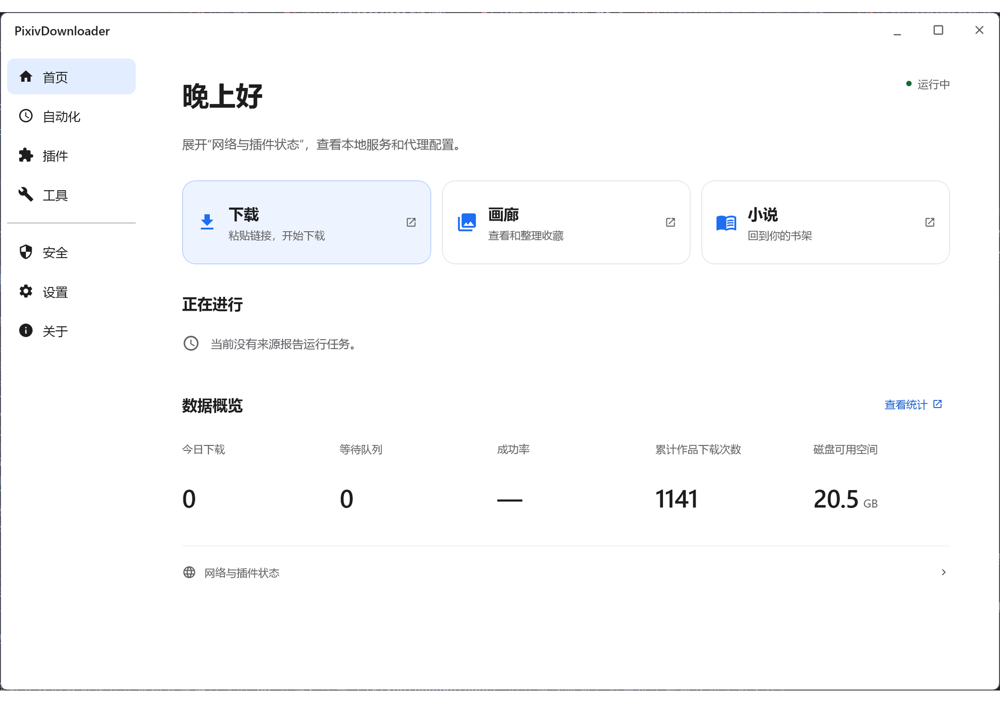

# PixivDownloader


中文 | [繁體中文](./README_zh-Hant.md) | [日本語](./README_ja.md) | [한국어](./README_ko.md) | [English](./README_en.md)

> [!NOTE]
> 此文档中提及的作品范围包括 插画/漫画/动图/小说

### 本地 Pixiv 作品批量下载工具，支持小说/漫画的各种类型下载

- 批量通过作品链接下载作品
- 通过用户ID批量下载作品
- 通过内置搜索代理批量下载作品
- 通过输入作品系列链接或者系列中作品链接批量下载整个系列作品
- 通过油猴脚本在 Pixiv 网页上抓取插画/漫画/动图/小说，或在单作品页直接下载
- 强大的作品/小说画廊

[](LICENSE)
[](https://github.com/Sywyar/PixivDownloader/stargazers)
[](../../releases)

## 功能特点

- 一站式下载网页，支持快捷获取、批量导入单作品、User 模式、Search 模式、系列模式
- 快捷获取：凭已保存的 Cookie 一键拉取本账户的收藏（插画/小说，含不公开）、自己的作品（含不公开）、关注列表、珍藏集，可钻取查看并加入下载队列
- 页面批量下载脚本 — 抓取搜索页、关注动态、排行榜等 Pixiv 页面中的插画/漫画/动图/小说
- 体验增强工具箱脚本（已下载标记、Cookie 导入）
- 强大的作品/小说画廊，支持搜索范围选择、筛选排序和收藏夹
- 小说画廊支持「正文」全文检索（基于本地全文索引，可与年龄分级/标签/作者等筛选叠加）
- 统计仪表盘：总览卡片、按月下载量折线、下载量 Top 作者、热门标签词云，作者/标签可点击直达画廊筛选
- 疑似重复检测：基于感知哈希（dHash）识别实质重复的已下载图片，支持阈值调节、跨作品/全部范围切换与手动扫描回填
- 插件管理页：卡片列表展示所有插件的状态/来源/版本/依赖，支持加载、启动、静默、停止、卸下、删除、重启和重载（未上线）
- 插件市场页：浏览、搜索、分页查看并安装受信仓库插件。第三方仓库在 GUI 的「设置 → 插件市场设置」中添加，可使用仓库描述符或自行填写；核对发布者、联网主机和完整公钥指纹后加入草稿，统一保存并重启生效。安装前会重新解析版本并校验大小、SHA-256、签名及包内描述符
- 计划任务：后台按周期或 Cron 自动发现并下载新作品，支持画师新作/保存的搜索/系列三类来源
- 邮件/推送通知：需人工介入的事件（鉴权失效、熔断等）通过邮件与推送通道告知；可在通知配置页按类型开关
- 小说下载与系列合订（TXT/HTML/EPUB，EPUB 支持多级目录和内嵌图片）
- 小说 AI 翻译（需配置大模型）：把正文或整个系列翻译成指定语言并保存到本地，可在原文与译文之间切换查看
- 小说 AI 多角色朗读（beta）：大模型逐句归属说话人，各角色固定音色合成并连续播放跟随高亮，分析结果可缓存重播
- 图片可多选原始格式、PNG、JPG、WebP；Ugoira 可多选 WebP、GIF、APNG、MP4 和原始 ZIP
- 自定义文件名模板（11 个变量）
- 已下载校验：数据库与磁盘不一致时自动清理脏记录或反向恢复记录
- 多用户场景配额和限流功能
- 访客邀请系统（分级/标签/作者白名单）
- 多语言/暗色模式
- 桌面 GUI（Swing + FlatLaf），在线更新
- 插件市场详情可按版本阅读 Markdown / HTML README、完整日志和本次更新说明，查看图标、截图及相关链接；文档按需加载，失败可重试。

## 使用截图

> [!NOTE]
> 少许截图设备启用了 HDR，颜色效果可能不同
>
> 应用支持简体中文界面；以下截图为简体中文版。

[](./readme/zh-CN/md/light-screenshot.md)

点击动图查看完整静态截图。

### [浅色模式使用截图](./readme/zh-CN/md/light-screenshot.md)

### [暗色模式使用截图](./readme/zh-CN/md/dark-screenshot.md)

## 快速开始

### 下载

从 [Releases](../../releases) 下载最新版：

| 类型                                  | 说明                                 |
|-------------------------------------|------------------------------------|
| `PixivDownload-*-win-x64-setup.exe` | Windows 安装包，内置 JRE，支持修复/更改/卸载，可选安装 FFmpeg；预置官方插件分发集合，不含 Douyin |
| `PixivDownload-*-java.zip`          | Java 标准包（跨平台），需 Java 17；与 Windows 安装包插件集合一致，不含 Douyin |
| `PixivDownload-*-full-offline.zip`  | 离线全量包（跨平台），需 Java 17；与 Java 标准包插件集合一致，不含 Douyin |

Java 标准包和离线全量包必须**完整解压**后使用，不要只提取其中的 JAR：启动脚本与 `plugins/` 目录
缺一不可，程序启动时会从工作目录的 `plugins/` 加载官方外置插件。

### 启动

```bash
# Windows 安装包
PixivDownload.exe

# Java 标准包 / 离线全量包（Windows）
run.bat

# Java 标准包 / 离线全量包（Linux/macOS，需 Java 17）
sh run.sh

# 可选参数
--no-gui    # 禁用 GUI，纯命令行运行（适合服务器/Docker）
--intro     # 启动时打开产品介绍页
```

首次启动后按引导完成配置，即可访问 `http://localhost:6999/pixiv-batch.html` 开始下载。

### 主数据库与历史迁移

默认安装独立的 SQLite 数据库插件，保留 `data/pixiv_download.db` 与旧目录定位规则。需要 PostgreSQL 17 / 18（UTF8）时，从插件市场安装 PostgreSQL 数据库插件并完整重启，再选择连接目标。主库和已适配的插件私有存储使用同一选定引擎；SQLite 私库仍位于 `data/{pluginId}/plugin.db`，PostgreSQL 私库按 owner 使用独立 schema 和受限账号。

在 Swing 或 Compose 的「设置 → 运行与网络 → 主数据库」，或插件市场的数据库设置中选择已加载插件，填写目标连接，再点击「检查并迁移」。连接字段及类型由数据库插件声明，选择 SQLite 时不显示连接字段，选择 PostgreSQL 时显示地址、用户名和密码。应用先只读检查连接、结构兼容性及目标，逐项列出主库、全部插件私库和需要重建的对象；确认前不会迁移数据或改写数据库配置。密码留空保留已存值，显式清除在确认后生效。环境变量或启动参数覆盖数据库配置时，页面会提示先处理覆盖。

确认后，桌面设置中的其它改动先按普通保存流程保存，应用随后停止业务并交接给新进程执行迁移。全部数据库复制、提交和核验成功后才切换数据库配置并启动；失败时仍使用源配置启动。设置页保留逐库结果，已提交的目标数据和源数据都不会自动删除。重试仍须点击「检查并迁移」：已提交库只有通过源变化、目标身份及实际内容核验后才可复用。

迁回已有数据的 SQLite 目标时，清单会提示备份和替换。确认后，提供者锁定旧库、保留包含已提交 WAL 的一致备份，再迁入暂存库。所有库核验通过后，各库分别通过事务替换原位置的内容；替换提交前失败会保留旧内容，已提交库和备份则保留供核验与重试。检查后旧目标发生变化或含有未知表时会拒绝替换。未实现安全替换能力的提供者仍要求空目标，停机 CLI 也始终要求空目标。

应用处于无库恢复状态且原连接配置无法解析时，清单会明确提示仅修正连接，不迁移原数据库的数据。检查新连接并确认后，应用保留原配置快照，再重启使用修正后的连接；私库迁移核验要求仍然有效。

迁移记录、配置快照和备份保存在 `data/database-migrations/`，其中配置和备份可能含凭据；不要删除这些文件，私库启动检查和失败重试仍会用到它们。每次任务中的 `target-*.backup` 保存被替换目标的旧内容，主库与各私库分别备份。迁移期间请关闭其它连接源库或目标库的应用与离线写入工具。

没有数据库插件、选中插件缺失 / 禁用 / 不兼容 / 加载失败，或启动时无法建立数据库连接，都会进入恢复模式：业务页面跳转市场，业务 API 返回 503；直接语义查询返回空并标明数据库不可用，写入与依赖数据库的后台操作停止。重新安装或启用原插件、修正连接后完整重启，不会自动改投其它引擎或新建空 SQLite。

配置文件使用以下扁平键。直接编辑配置不会复制历史数据；已有数据应先通过设置页或下述停机工具迁移：

```yaml
database.provider: database-postgresql
database.engine: postgresql
database.jdbc-url: "jdbc:postgresql://db.example.com:5432/pixiv?currentSchema=pixiv&sslmode=verify-full"
database.username: pixiv_app
database.password: "替换为数据库密码"
```

请先创建专用数据库和主库 schema，授予应用账号相应的建表、索引、序列、函数、触发器及数据读写权限。使用插件私库还需要 `CREATEROLE` 和数据库上的 `CREATE` 权限，以建立独立登录角色与 schema；不能向 `PUBLIC` 开放主库或其它 owner 的数据权限，否则隔离检查会拒绝私库连接。`currentSchema` 只能指定一个小写字母、数字或下划线组成的名称（首字符不能是数字，最多 63 字符）；省略时使用 `public`。远程连接建议使用 `sslmode=verify-full`，需要自定义 CA 时添加 `sslrootcert`。JDBC 直接连接管理员指定的服务器，不使用 Pixiv HTTP 代理。密码放在独立配置项或 `DATABASE_PASSWORD` 环境变量中，不能写入 JDBC URL。连接检查失败会显示错误；启动时无法建立目标连接会进入恢复模式，不会回落到空 SQLite。

也可单独使用停机迁移工具。先安装并启用源、目标数据库插件，停止所有使用源库的应用、插件和离线写入工具；保持作品文件、插件私有库、参考音、配置及凭据文件可用。分别把完整连接设置写入独立的 `source.yaml` 和 `target.yaml`，两者都必须明确填写 `database.provider`。SQLite 源可配置 `database.provider: database-sqlite` 和 `database.jdbc-url: "jdbc:sqlite:data/pixiv_download.db"`。保留这两份配置，迁移后也不要覆盖 `source.yaml`，私库检查仍需用它定位原库。在完整解压目录运行下列命令，将 `<boot.jar>` 替换为实际应用 boot JAR 文件名：

```powershell
java '-Dloader.main=top.sywyar.pixivdownload.migration.DatabaseMigration' -cp '<boot.jar>' org.springframework.boot.loader.launch.PropertiesLauncher --source-config source.yaml --target-config target.yaml --backup migration/source.backup --report migration/report.json
```

同一入口支持 SQLite 与 PostgreSQL 双向迁移。源提供者负责锁和一致快照，目标提供者负责空库检查、结构与数据写入和回读验证。SQLite 备份包含已提交 WAL，旧结构只在临时副本上升级；PostgreSQL 源须符合当前支持的结构，备份是包含数据、序列及受支持对象定义的格式 1 逻辑 XML，不是 `pg_dump` 文件，当前工具没有直接恢复该归档的入口。新增满足 SDK 迁移合同的提供者无需修改宿主迁移工具；缺席或禁用的源提供者会阻止迁移，不能借用其它驱动。

迁移保留 ID、毫秒时间、NULL、二进制、软删除、元数据、媒体和文件引用，核对每表行数、类型化 SHA-256 摘要、引用警告及生成键历史高水位。备份可能含计划凭据，应作为敏感文件保管。目标非空、源表没有所属声明或类型不兼容时会停止，不会清空目标、删除孤儿记录或略过未知表。

通过中性存储接口写入的文本参数会由数据库提供者统一移除 NUL（U+0000），保留换行、制表符、其他有效 Unicode 字符、空串及 NULL；二进制内容不变，非法编码仍拒绝写入。迁移已有文本时，在临时工作副本中执行相同处理，再核对目标实际内容，源库与原始备份不变。清洗后若出现唯一键冲突或违反约束，迁移会失败，不会自动合并或删除记录。

可再生对象须显式确认：SQLite 小说源可添加 `--rebuild-objects novels_fts,novel_soft_delete_cleanup`，列表中只填实际存在的对象；PostgreSQL 源须列出实际存在的触发器和函数名。先确认所属插件能在目标上重建这些对象；普通历史表不能用此参数排除。

已安装但禁用的插件仍提供迁移声明。准备卸载保留数据库数据的插件前，可用同一入口的 `--export-schema schema.json` 保存声明；迁移时用 `--retained-schema schema.json` 补入缺席 owner，文件必须匹配当前 SDK。缺少声明时先恢复相应插件或补齐经核对的声明，不要删除历史表。

工具同时迁移声明了兼容私有 schema 的所有 owner 数据，枚举和隔离由各提供者负责。未知 owner 或缺少私有声明会在复制前拒绝。全部库复制核验后才开始逐库提交，部分失败不会撤销已提交库。切换与启动检查通过可信源提供者复核私库变化凭据和目标身份；源配置、源数据或目标改变时拒绝切换。业务插件通过中性存储契约读写并声明结构及业务转换，提供者负责物理映射、SQL 方言和迁移。第三方插件自带的 JDBC 或数据库专用 SQL 仍需作者适配，迁移工具不会自动翻译任意 SQL。作品、参考音和凭据文件保留原位。

报告和私库收据使用 `formatVersion: 1`；交换模型与收据拒绝未知格式。报告的 `stores` 逐库记录 `COMMITTED`、`ROLLED_BACK` 或 `UNKNOWN`；取消或失败会中止尚未尝试提交的会话，不能将部分提交报告为整体回滚。提交时断连、进程被强制终止或报告落盘失败可能留下 `COMMITTING`、`UNKNOWN` 或旧进度，须人工核对目标。失败可能留下空数据库文件、私库 schema 或角色，工具不自动删除。

CLI 报告只有 `DATA_VERIFIED` 表示全部提交、收据和资源释放均已完成。CLI 不自动切换配置：检查引用警告和待重建对象，再修改生效配置、完整启动应用并核验画廊、小说搜索、通知、计划及文件访问。`IN_PROGRESS` 或 `FAILED_TARGET_NOT_VERIFIED` 均不表示成功。CLI 重试使用新备份和经确认的空目标；设置页则可在重新核验后复用本次切换任务已提交的库。切换后尚无新写入时可以停机恢复原配置；目标已有增量时不能直接回切，否则会丢失增量。

### 让网页版 Pixiv 走后端配置的代理（无需开启系统代理）

后端访问 Pixiv 走配置里指定的代理（默认 `127.0.0.1:7890`），不依赖系统代理。如果你还希望在浏览器里直接打开 `pixiv.net`（例如配合油猴脚本），又不想为此开启 Clash 的「系统代理 / system proxy」，可以使用内置的代理自动配置（PAC）：

在系统或浏览器的「自动代理配置脚本（PAC）URL」处填入 `http://localhost:6999/proxy.pac`（端口与你的配置一致；启用 HTTPS 时为 `https://<域名>:<端口>/proxy.pac`），即可让仅 Pixiv 相关域名走后端配置的同一个代理、其余流量直连。该地址仅本机可访问，代理变更（含热重载）会自动反映到 PAC 内容；不再需要来回切换系统代理。

各浏览器 / 系统的具体设置入口地址（Firefox `about:preferences#general`、Windows `ms-settings:network-proxy` 等）见[配置参考 · 让网页版 Pixiv 走同一个代理](https://sywyar.github.io/PixivDownloader/#/zh-cn/configuration)。

---

## 插件开发模式

显式启用 `dev-mode` 时，程序同时加载当前开发构建的源码输出与 `plugins/` 中通过校验的安装包。两种来源共同检查依赖；同一插件 ID 来自多个位置时，冲突的副本均不会加载，恢复界面会列出来源及处理建议。调试源码时移出同名安装包；使用安装包时从开发构建中排除同名源码模块，处理后重启。

## 在线文档

详细的安装步骤、使用指南、配置参考、开发指南等请查阅[在线文档](https://sywyar.github.io/PixivDownloader/#/zh-cn/)，也可切换到[繁體中文文檔](https://sywyar.github.io/PixivDownloader/#/zh-hant/)。各章节快速跳转：

**快速上手**

- [📥 安装与启动](https://sywyar.github.io/PixivDownloader/#/zh-cn/installation)
- [⚙️ 首次配置](https://sywyar.github.io/PixivDownloader/#/zh-cn/first-setup)
- [⬇️ 第一次下载](https://sywyar.github.io/PixivDownloader/#/zh-cn/first-download)

**功能指南**

- [⚡ 快捷获取](https://sywyar.github.io/PixivDownloader/#/zh-cn/quick-access)
- [📋 URL 批量下载](https://sywyar.github.io/PixivDownloader/#/zh-cn/batch-download)
- [👤 画师批量下载](https://sywyar.github.io/PixivDownloader/#/zh-cn/user-download)
- [🔍 搜索下载](https://sywyar.github.io/PixivDownloader/#/zh-cn/search)
- [📖 小说下载](https://sywyar.github.io/PixivDownloader/#/zh-cn/novel)
- [🖼️ 作品画廊](https://sywyar.github.io/PixivDownloader/#/zh-cn/gallery)
- [⏰ 计划任务](https://sywyar.github.io/PixivDownloader/#/zh-cn/scheduled-tasks)
- [🧩 油猴脚本](https://sywyar.github.io/PixivDownloader/#/zh-cn/userscripts)

**参考**

- [⚙️ 配置参考](https://sywyar.github.io/PixivDownloader/#/zh-cn/configuration)
- [🔌 插件管理](https://sywyar.github.io/PixivDownloader/#/zh-cn/plugin-management)
- [🧩 第三方插件 SDK](https://sywyar.github.io/PixivDownloader/#/zh-cn/plugin-development)
- [📦 插件 SDK 下载与版本记录](https://github.com/Sywyar/PixivDownloader-Plugin-SDK/releases)（列表为空表示尚未公开发布）
- [💾 存储原理](https://sywyar.github.io/PixivDownloader/#/zh-cn/storage)
- [❓ 常见问题](https://sywyar.github.io/PixivDownloader/#/zh-cn/faq)
- [🛠️ 开发指南](https://sywyar.github.io/PixivDownloader/#/zh-cn/development)

---

## 许可证与插件

本项目及官方插件采用 [AGPL-3.0](LICENSE)，符合[插件链接例外](PLUGIN-LINKING-EXCEPTION.txt)条件的独立第三方插件可选择 MIT 许可证。

## 免责声明

- 本项目仅供个人学习和研究使用，请勿用于任何商业用途。
- 使用本工具下载的内容版权归原作者所有，请尊重创作者权益，不得二次传播或商业使用。
- 本工具通过用户自行提供的 Cookie 或在经过用户允许下通过油猴脚本提取 Cookie 来访问 Pixiv，使用者需自行承担账号风险
- 本项目与 Pixiv 官方无任何关联，使用本工具产生的一切后果由使用者自行负责。
- 请合理设置下载间隔，避免对 Pixiv 服务器造成过大压力。

---

## 闲言碎语

说真的我其实并不推荐这个工具的多人模式，因为所有的请求走的都是服务器网络的IP，就算cookie不一样请求量大也有可能封IP，我也在考虑在多人模式下添加一个登录机制，但与项目方便的初衷背道而驰，目前只会继续打磨这个项目

## 友情链接

**[PixivBatchDownloader](https://github.com/xuejianxianzun/PixivBatchDownloader)**
如果希望直接在浏览器中下载、不依赖后端程序，可以使用这个扩展。

在本软件中具有 **PixivBatchDownloader 导入支持** 插件及油猴脚本，可将此后下载完成的插画、漫画、动图和小说自动加入本机画廊，保留原文件。详见[使用说明](https://sywyar.github.io/PixivDownloader/#/zh-cn/pixiv-batch-downloader-import)。

功能介绍：

- 超多筛选支持
- 有一些辅助功能，如去除广告、快速收藏、看图模式等 `(可以当作一个 Pixiv 的辅助插件？)`
- 下载不依赖第三方工具 `(与本项目最大的区别！安装十分方便！我也在努力将我的项目的使用变得简洁)`
- 支持多语言
