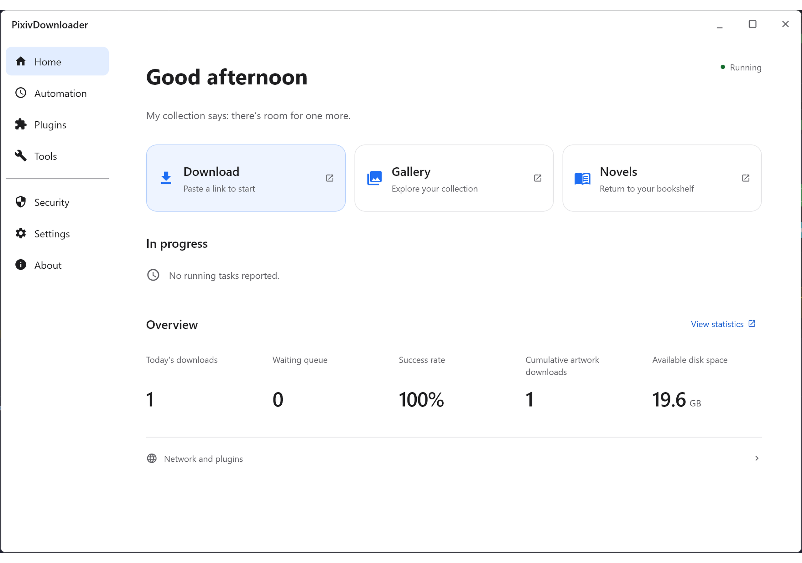

# PixivDownloader


[中文](./README.md) | [繁體中文](./README_zh-Hant.md) | [日本語](./README_ja.md) | [한국어](./README_ko.md) | English

> [!NOTE]
> In this document, "works" includes illustrations, manga, ugoira, and novels.

### Local batch downloader for Pixiv works, supporting novels, manga, and other work types

- Batch download works from work links
- Batch download works by user ID
- Batch download works through the built-in search proxy
- Batch download an entire series by entering a series link or a work link from that series
- Use Tampermonkey userscripts to scrape illustrations, manga, ugoira, and novels from Pixiv pages, or download directly
  from single-work pages
- Powerful artwork and novel galleries

[](LICENSE)
[](https://github.com/Sywyar/PixivDownloader/stargazers)
[](../../releases)

## Features

- One-stop download web page: Quick Fetch, Bulk Import Single Works, User Mode, Search Mode, Series Mode
- Quick Fetch: with the saved Cookie, one-click load your own bookmarks (illust/novel, incl. private), your own works (incl. private), following list, and collections; drill in and add to the download queue
- Page batch download userscript — scrape works from search results, following feed, rankings, and more
- Experience-enhancement toolbox (downloaded-work marking, one-click Cookie import)
- Powerful artwork and novel galleries with search-scope selection, filtering, sorting, and collections
- Full-text "body" search in the novel gallery (backed by a local full-text index; combinable with age-rating / tag /
  author filters)
- Statistics dashboard: overview cards, downloads-by-month line chart, top authors by downloads, popular-tag
  cloud; authors/tags are clickable and jump to a filtered gallery view
- Suspected-duplicate detection: identifies substantially duplicate downloaded images via perceptual hashing (
  dHash), with adjustable threshold, cross-artwork/all scope switching, and manual scan backfill
- Plugin management page: a card list showing every plugin with status, source, version, and dependencies; load, start, quiet, stop, unload, remove, restart, and reload actions for external plugins (Not yet launched)
- Plugin marketplace page: browse, search, page through and install plugins from trusted repositories. Add third-party repositories in GUI Settings → Plugin market settings, using a repository descriptor or manual entry. Review the publisher, network hosts and full public-key fingerprints, add the repository to the draft, then save settings and restart. Before installation, the host resolves the version again and verifies size, SHA-256, signature and the package descriptor
- Scheduled tasks: automatically discover and download new works in the background on a fixed interval or cron schedule, supporting three source types
- Email / push notifications: events needing manual attention are delivered via email and push channels; each notification type individually toggleable
- Novel download and series compilation (TXT/HTML/EPUB with multi-level TOC and embedded images)
- Novel AI translation (requires an LLM configured): translate a novel or a whole series into a chosen language and store it locally, with a content-language switch between the original and translations
- Novel AI multi-voice narration (beta): an LLM attributes sentences to speakers, each character synthesized with a fixed voice and played back with follow-along highlighting; analysis is cached for replay

- Save images in original, PNG, JPG and WebP formats; save Ugoira as WebP, GIF, APNG, MP4 and the original ZIP
- Custom file naming templates (11 variables)
- Downloaded-state verification: stale DB records auto-pruned; missing records reconstructed from disk to skip re-download
- Quota and rate limiting for multi-user scenarios
- Guest invite system (age-rating / tag / author whitelist)
- Multiple languages / dark mode
- Desktop GUI (Swing + FlatLaf) with online update
- Marketplace details display versioned Markdown / HTML README, full changelog, release notes, icons, screenshots and related links. Documents load on demand and failed reads can be retried.

## Screenshots

> [!NOTE]
> Some screenshot devices have HDR enabled, so the color effect may differ.
>
> The application supports English. The application screenshots below use English; the two userscript screenshots use Simplified Chinese.

[](./readme/en-US/md/light-screenshot.md)

Click the animation to view the full static screenshots.

### [Light Mode Screenshots](./readme/en-US/md/light-screenshot.md)

### [Dark Mode Screenshots](./readme/en-US/md/dark-screenshot.md)

## Quick Start

### Download

Download the latest version from [Releases](../../releases):

| Type                                | Description                                                                                          |
|-------------------------------------|------------------------------------------------------------------------------------------------------|
| `PixivDownload-*-win-x64-setup.exe` | Windows installer with bundled JRE; repair/change/uninstall and optional FFmpeg installation; includes the official plugin distribution set, without Douyin |
| `PixivDownload-*-java.zip`          | Java standard package (cross-platform), requires Java 17; same plugin set as the Windows installer, without Douyin |
| `PixivDownload-*-full-offline.zip`  | Full-offline package (cross-platform), requires Java 17; same plugin set as the Java standard package, without Douyin |

The Java standard package and the full-offline package must be **fully extracted** before use — do not take out only
the JAR: the launcher scripts and the `plugins/` directory are both required, because external official plugins are
loaded from the working directory's `plugins/` folder at startup.

### Run

```bash
# Windows installer
PixivDownload.exe

# Java standard / full-offline package (Windows)
run.bat

# Java standard / full-offline package (Linux/macOS, requires Java 17)
sh run.sh

# Optional arguments
--no-gui    # Disable the GUI and run in CLI-only mode (server/Docker)
--intro     # Open the product introduction page on startup
```

After first startup, follow the wizard to complete setup, then visit `http://localhost:6999/pixiv-batch.html` to start
downloading.

### Main database and existing data

The default installation includes a separate SQLite database plugin and preserves `data/pixiv_download.db` and discovery of its legacy location. To use PostgreSQL 17 or 18 with UTF8, install its database plugin from the market, fully restart, then select the connection target. The main database and adapted private plugin storage use the selected engine. SQLite private databases remain at `data/{pluginId}/plugin.db`; PostgreSQL gives each owner a separate schema and restricted login.

In Swing or Compose Settings → Runtime and network → Main database, or in the plugin market's database settings, select a loaded plugin, enter the destination connection and choose **Check and migrate**. Each database plugin declares its connection fields and their types: SQLite shows none; PostgreSQL shows the address, username and password. Read-only checks cover the connection, schema compatibility and destination. The page lists the main database, every private plugin database and objects to recreate. It does not migrate data or change database configuration before confirmation. Leave the password empty to retain it, or explicitly clear it for the confirmed change. Resolve any reported environment or startup-argument overrides first.

After confirmation, other desktop settings are saved through the normal save flow. The application then stops business operations and hands migration to a new process. Database configuration changes only after every database has been copied, committed and verified. A failed migration starts with the source configuration. The settings page retains per-database results; neither source data nor committed destination data is automatically deleted. Retry through **Check and migrate**: committed databases can be reused only after source revision, destination identity and actual contents pass verification.

When migrating back to a SQLite destination that contains data, the checklist explains the backup and replacement. After confirmation, the provider locks the old database, saves a consistent backup including committed WAL data, and imports into a temporary database. Once every database passes verification, each destination's contents are replaced in a separate transaction at the original location. Failure before a replacement commits preserves the old contents; committed destinations and backups remain available for verification and retry. Changes to the old destination after inspection, or unknown tables, block replacement. Providers without safe replacement support still require an empty destination, as does the offline CLI.

When no database is active and the original connection configuration cannot be parsed, the checklist identifies the operation as a connection repair. It does not migrate data from the original database. After checking the new connection and receiving confirmation, the application preserves a configuration snapshot and restarts with the corrected connection. Private database migration checks still apply.

Migration records, configuration snapshots and backups remain in `data/database-migrations/`. Configuration and backups may contain credentials. Preserve these files for private database startup checks and retries. Each task's `target-*.backup` files retain the replaced destination's old contents, with separate backups for the main database and each private database. Close any other application or offline writer connected to either endpoint during migration.

The application enters recovery mode when no database plugin is available, the selected plugin is missing, disabled, incompatible or fails to load, or the database connection cannot be established at startup. Business pages redirect to the market and business APIs return 503. Direct semantic queries return empty results with an unavailable status; writes and dependent background operations stop. Repair the selected plugin or connection and fully restart. Recovery never selects another engine or creates an empty SQLite database automatically.

The configuration file uses these flat keys. Editing them directly does not copy existing data; migrate it through the settings page or the offline tool below first:

```yaml
database.provider: database-postgresql
database.engine: postgresql
database.jdbc-url: "jdbc:postgresql://db.example.com:5432/pixiv?currentSchema=pixiv&sslmode=verify-full"
database.username: pixiv_app
database.password: "replace-with-database-password"
```

Create a dedicated database and main schema first. The application account needs access to data and permission to create tables, indexes, sequences, functions and triggers. Private plugin storage also requires `CREATEROLE` and `CREATE` on the database to create separate logins and schemas. Do not grant `PUBLIC` access to the main database's or other owners' data; isolation checks reject private connections with those privileges. `currentSchema` accepts one name of at most 63 lowercase ASCII letters, digits or underscores, starting with a letter or underscore; it defaults to `public`. Use `sslmode=verify-full` for remote connections and `sslrootcert` when a custom CA is required. JDBC connects directly to the administrator's chosen server and does not use the Pixiv HTTP proxy. Keep the password in its separate configuration field or the `DATABASE_PASSWORD` environment variable, never in the JDBC URL. Failed connection checks report an error. If startup cannot establish the selected connection, the application enters recovery without falling back to an empty SQLite database.

The offline migration tool can also be used separately. Install and enable both providers, then stop every application, plugin and offline writer using the source. Keep artwork, private databases, reference audio, configuration and credentials available. Save complete endpoint settings in separate `source.yaml` and `target.yaml` files, each explicitly setting `database.provider`. A SQLite source can use `database.provider: database-sqlite` and `database.jdbc-url: "jdbc:sqlite:data/pixiv_download.db"`. Preserve both files, including the unchanged `source.yaml`: private database checks use it to locate the original source. From the fully extracted application directory, replace `<boot.jar>` with the application boot JAR filename and run:

```powershell
java '-Dloader.main=top.sywyar.pixivdownload.migration.DatabaseMigration' -cp '<boot.jar>' org.springframework.boot.loader.launch.PropertiesLauncher --source-config source.yaml --target-config target.yaml --backup migration/source.backup --report migration/report.json
```

The same entry point supports both directions between SQLite and PostgreSQL. The source provider owns locking and consistent snapshots; the destination provider checks that the target is empty, creates its structures, imports data and verifies the result. SQLite backups include committed WAL data, and old structures are upgraded only in a temporary copy. PostgreSQL sources must use a supported current schema. Its format 1 logical XML backup contains data, sequences and supported object definitions; it is not a `pg_dump` file, and the tool currently has no direct restore entry point for that archive. Adding a provider that implements the SDK migration contract does not require changes to the host tool. Missing or disabled source providers block migration; another driver cannot substitute for them.

Migration preserves IDs, millisecond timestamps, NULLs, binary values, soft deletion, metadata, media and file references. It compares table counts, typed SHA-256 digests, reference warnings and generated key high-water marks. Backups may contain schedule credentials and must be protected. Nonempty destinations, undeclared source tables and incompatible values stop migration. The tool never clears destinations, deletes orphan records or skips unknown tables.

Database providers remove NUL (U+0000) from text parameters written through the neutral storage interface. Line breaks, tabs, other valid Unicode characters, empty strings, NULLs and binary data are preserved; malformed encoding is rejected. Migration applies the same rule to a temporary working copy before verifying the destination contents. The source and original backup remain unchanged. If normalization causes a unique-key conflict or violates a constraint, migration fails without merging or deleting records.

Explicitly acknowledge regenerable objects with `--rebuild-objects`. A SQLite novel source can list `novels_fts,novel_soft_delete_cleanup` when those objects exist. For PostgreSQL sources, list the actual trigger and function names. Confirm that the owning plugin can recreate them on the destination. This option cannot exclude ordinary history tables.

Installed but disabled plugins still supply migration declarations. Before uninstalling a plugin whose database data must be retained, use this entry point with `--export-schema schema.json` to save its declarations. Add `--retained-schema schema.json` during migration to restore declarations for absent owners; the manifest must match the current SDK. Restore the plugin or provide verified declarations when they are missing, rather than deleting historical tables.

The tool migrates every owner database with compatible private schema declarations. Providers own discovery and isolation. Unknown owners or missing declarations block copying. All databases are copied and verified before individual commits begin; partial failure cannot undo earlier commits. Switch and startup checks use the trusted source provider to verify private source revisions and destination identities. Source configuration, data or target changes invalidate receipts. Business plugins declare structures and business conversions and use the neutral storage contract for reads and writes. Providers own physical mapping, SQL dialects and migration. Third-party plugins bundling JDBC or database-specific SQL still need adaptation; the tool does not translate arbitrary SQL. Artwork, reference audio and credential files stay in place.

Reports and private receipts use `formatVersion: 1`; exchange models and receipts reject unknown formats. Each report entry in `stores` records its own `COMMITTED`, `ROLLED_BACK` or `UNKNOWN` outcome. Cancellation or failure aborts sessions that have not attempted commit. A partial commit cannot be reported as complete rollback. Disconnection during commit, forced termination or report persistence failure may leave `COMMITTING`, `UNKNOWN` or earlier progress on disk; inspect the destination before retrying. Empty destination files, private schemas or roles may remain after failure and are not deleted automatically.

Only `DATA_VERIFIED` in the CLI report confirms that commits, receipts and resource release all succeeded. The CLI does not switch configuration automatically. Review reference warnings and objects awaiting recreation, then change the active configuration, restart the application and check the gallery, novel search, notifications, schedules and file access. Neither `IN_PROGRESS` nor `FAILED_TARGET_NOT_VERIFIED` indicates success. CLI retries need new backups and a confirmed empty destination; the settings page can reuse committed databases from its switch task after fresh verification. Before any new destination writes, you can stop the application and restore the original configuration. Switching back after new writes would lose those changes.

### Route web Pixiv through the backend-configured proxy (no system proxy needed)

The backend reaches Pixiv through the proxy in your config (default `127.0.0.1:7890`) and does not rely on a system
proxy. If you also want to open `pixiv.net` directly in the browser (e.g. with the userscripts) without turning on
Clash's system proxy, use the built-in proxy auto-config (PAC):

Set your OS/browser "Automatic proxy configuration script (PAC) URL" to `http://localhost:6999/proxy.pac` (match your
configured port; with HTTPS enabled it becomes `https://<domain>:<port>/proxy.pac`). Only Pixiv-related domains then go
through the same backend-configured proxy while everything else stays direct. The endpoint is local-only, and proxy
changes (including hot reload) are reflected automatically — no more toggling the system proxy back and forth.

For the exact settings entry points per browser/OS (Firefox `about:preferences#general`, Windows
`ms-settings:network-proxy`, etc.), see [Configuration · Route web Pixiv through the same
proxy](https://sywyar.github.io/PixivDownloader/#/en/configuration).

---

## Plugin development mode

With `dev-mode` explicitly enabled, the application loads source outputs from the current development build alongside verified packages in `plugins/`. Dependencies are checked across both sources. If multiple locations provide the same plugin ID, none of the conflicting copies are loaded; the recovery interface lists the sources and suggested actions. Move the duplicate installed package out when debugging source, or exclude the matching source module from the development build when using the package, then restart.

## Online Documentation

For detailed installation steps, usage guides, configuration reference, and development guides, see the
[online documentation](https://sywyar.github.io/PixivDownloader/#/en/). Traditional Chinese readers can switch to the
[繁體中文 documentation](https://sywyar.github.io/PixivDownloader/#/zh-hant/). Quick jump to each section:

**Quick Start**

- [📥 Installation & Startup](https://sywyar.github.io/PixivDownloader/#/en/installation)
- [⚙️ First-Time Setup](https://sywyar.github.io/PixivDownloader/#/en/first-setup)
- [⬇️ First Download](https://sywyar.github.io/PixivDownloader/#/en/first-download)

**Feature Guide**

- [⚡ Quick Fetch](https://sywyar.github.io/PixivDownloader/#/en/quick-access)
- [📋 URL Batch Download](https://sywyar.github.io/PixivDownloader/#/en/batch-download)
- [👤 Artist Batch Download](https://sywyar.github.io/PixivDownloader/#/en/user-download)
- [🔍 Search Download](https://sywyar.github.io/PixivDownloader/#/en/search)
- [📖 Novel Download](https://sywyar.github.io/PixivDownloader/#/en/novel)
- [🖼️ Artwork Gallery](https://sywyar.github.io/PixivDownloader/#/en/gallery)
- [⏰ Scheduled Tasks](https://sywyar.github.io/PixivDownloader/#/en/scheduled-tasks)
- [🧩 Userscripts](https://sywyar.github.io/PixivDownloader/#/en/userscripts)

**Reference**

- [⚙️ Configuration](https://sywyar.github.io/PixivDownloader/#/en/configuration)
- [🔌 Plugin Management](https://sywyar.github.io/PixivDownloader/#/en/plugin-management)
- [🧩 Third-party Plugin SDK](https://sywyar.github.io/PixivDownloader/#/en/plugin-development)
- [📦 Plugin SDK downloads and release history](https://github.com/Sywyar/PixivDownloader-Plugin-SDK/releases) (an empty list means no SDK has been published)
- [💾 Storage Principles](https://sywyar.github.io/PixivDownloader/#/en/storage)
- [❓ FAQ](https://sywyar.github.io/PixivDownloader/#/en/faq)
- [🛠️ Development](https://sywyar.github.io/PixivDownloader/#/en/development)

---

## License and plugins

This project and its official plugins use [AGPL-3.0](LICENSE). Independent third-party plugins may choose the MIT License when they meet the [Plugin Linking Exception](PLUGIN-LINKING-EXCEPTION.txt).

## Disclaimer

- This project is for personal learning and research only; do not use it for any commercial purposes.
- Content downloaded using this tool is copyrighted by the original creators; please respect creators' rights and do not
  redistribute or use commercially.
- This tool accesses Pixiv through user-provided cookies or, with user permission, by extracting cookies via
  Tampermonkey userscripts; users bear their own account risks.
- This project has no affiliation with Pixiv; all consequences of using this tool are the user's responsibility.
- Please set a reasonable download interval to avoid excessive load on Pixiv servers.

---

## Additional Notes

Honestly, I don't really recommend the multi mode of this tool, because all requests go through the server's network IP.
Even with different cookies, a large number of requests could lead to IP bans. I'm considering adding a login mechanism
to multi mode, but that goes against the project's original intention of simplicity. For now, I'll just continue
refining this project.

## Friend Links

**[PixivBatchDownloader](https://github.com/xuejianxianzun/PixivBatchDownloader)**
If you want to download directly in your browser without a backend, try this extension.

PixivDownloader provides the **PixivBatchDownloader import support** plugin and userscript to automatically add newly completed illustrations, manga, animations and novels to the local gallery while preserving the original files. See the [usage guide](https://sywyar.github.io/PixivDownloader/#/en/pixiv-batch-downloader-import).

Features:

- Many filtering options
- Useful auxiliary features like ad removal, quick bookmark, image viewer mode, etc.
  `(can also serve as a Pixiv helper plugin?)`
- Download doesn't depend on third-party tools `(the biggest difference from this project! Easy installation!)`
- Supports multiple languages
