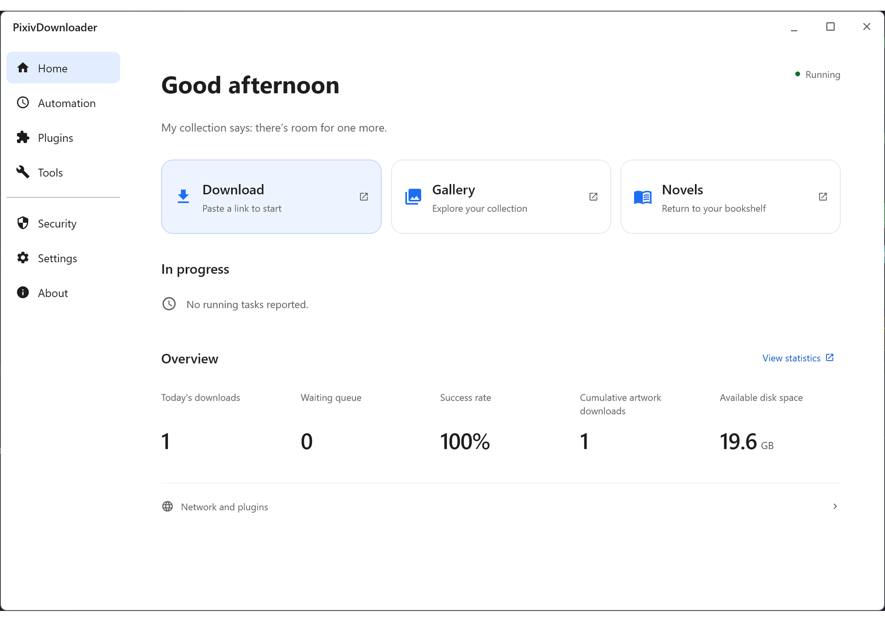

# PixivDownloader

[中文](./README.md) | [繁體中文](./README_zh-Hant.md) | [日本語](./README_ja.md) | [한국어](./README_ko.md) | English

PixivDownloader is a local batch downloader and gallery manager for Pixiv illustrations, manga, Ugoira animations, and novels, offering desktop UIs (Compose / Swing), a browser download workbench, and Tampermonkey userscripts.

## Key Features

- **Flexible acquisition and batch downloads**: Supports [Quick Fetch](https://sywyar.github.io/PixivDownloader/#/en/quick-access) (bookmarks, your works, commissions, followed artists' new works, collections), [URL Batch Download](https://sywyar.github.io/PixivDownloader/#/en/batch-download), [Artist Batch Download](https://sywyar.github.io/PixivDownloader/#/en/user-download), [Search Download](https://sywyar.github.io/PixivDownloader/#/en/search), manga/novel series downloads, and [Tampermonkey userscripts](https://sywyar.github.io/PixivDownloader/#/en/userscripts).
- **Media transcoding and novel workflows**: Save images in multiple formats (original, PNG, JPG, WebP) and Ugoira animations as WebP, GIF, APNG, MP4, or original ZIP; [Novels](https://sywyar.github.io/PixivDownloader/#/en/novel) support TXT / HTML / EPUB (including compiled series EPUB3), full-text search, AI / Youdao / LibreTranslate translation, and AI multi-speaker narration.
- **Local gallery and organization**: The [Artwork Gallery](https://sywyar.github.io/PixivDownloader/#/en/gallery) and Novel Gallery provide multi-criteria filtering, tri-state tag/author rules, local collections, batch ZIP export, a statistics dashboard, perceptual-hash (dHash) duplicate detection, and read-only guest invitations.
- **Scheduled tasks and notifications**: [Scheduled Tasks](https://sywyar.github.io/PixivDownloader/#/en/scheduled-tasks) discover and download new works on fixed intervals or 6-field Cron schedules with incremental watermarks, sending email and push notifications on credential expiration, overuse warnings, or circuit-breaker pauses.
- **Plugin architecture and extensible UI**: Includes Compose and Swing desktop interfaces, SQLite and optional PostgreSQL database providers, [Plugin Management & Marketplace](https://sywyar.github.io/PixivDownloader/#/en/plugin-management), [Page Editor](https://sywyar.github.io/PixivDownloader/#/en/page-editor), [Operation CAPTCHA](https://sywyar.github.io/PixivDownloader/#/en/captcha), [PixivBatchDownloader Import Support](https://sywyar.github.io/PixivDownloader/#/en/pixiv-batch-downloader-import), and the public [Third-party Plugin SDK](https://sywyar.github.io/PixivDownloader/#/en/plugin-development).

## Screenshots

> Some screenshot devices had HDR enabled, so colors may vary. Click the preview animation to view full static screenshots.

- [Light Mode Screenshots](./readme/en-US/md/light-screenshot.md) · [Dark Mode Screenshots](./readme/en-US/md/dark-screenshot.md)

## Quick Start

### 1. Download a Release Package

Download the latest version from [Releases](../../releases). Use the package table in that release's notes to choose the appropriate download.

### 2. Launch and Initialize

Follow [Installation and Launch](https://sywyar.github.io/PixivDownloader/#/en/installation), then complete [First-Time Setup](https://sywyar.github.io/PixivDownloader/#/en/first-setup).

## Online Documentation

For complete configuration, migration, troubleshooting, and development guides, visit the [Online Documentation](https://sywyar.github.io/PixivDownloader/#/en/):

- **Get Started**: [Installation](https://sywyar.github.io/PixivDownloader/#/en/installation) · [First-Time Setup](https://sywyar.github.io/PixivDownloader/#/en/first-setup) · [First Download](https://sywyar.github.io/PixivDownloader/#/en/first-download)
- **Find and Download**: [Quick Fetch](https://sywyar.github.io/PixivDownloader/#/en/quick-access) · [URL Batch Download](https://sywyar.github.io/PixivDownloader/#/en/batch-download) · [Artist Downloads](https://sywyar.github.io/PixivDownloader/#/en/user-download) · [Search](https://sywyar.github.io/PixivDownloader/#/en/search) · [Novels and Narration](https://sywyar.github.io/PixivDownloader/#/en/novel) · [Scheduled Tasks](https://sywyar.github.io/PixivDownloader/#/en/scheduled-tasks) · [Userscripts](https://sywyar.github.io/PixivDownloader/#/en/userscripts) · [Import External Downloads](https://sywyar.github.io/PixivDownloader/#/en/pixiv-batch-downloader-import)
- **Manage and Troubleshoot**: [Artwork Gallery](https://sywyar.github.io/PixivDownloader/#/en/gallery) · [Configuration](https://sywyar.github.io/PixivDownloader/#/en/configuration) · [Storage and Backup](https://sywyar.github.io/PixivDownloader/#/en/storage) · [CLI and Advanced Reference](https://sywyar.github.io/PixivDownloader/#/en/usage-guide) · [Network Access](https://sywyar.github.io/PixivDownloader/#/en/network-access) · [FAQ](https://sywyar.github.io/PixivDownloader/#/en/faq)
- **Plugins and Development**: [Plugin Management](https://sywyar.github.io/PixivDownloader/#/en/plugin-management) · [Page Editor](https://sywyar.github.io/PixivDownloader/#/en/page-editor) · [Operation CAPTCHA](https://sywyar.github.io/PixivDownloader/#/en/captcha) · [Third-party Plugin SDK](https://sywyar.github.io/PixivDownloader/#/en/plugin-development) · [Main Repository Development](https://sywyar.github.io/PixivDownloader/#/en/development) · [SDK Releases](https://github.com/Sywyar/PixivDownloader-Plugin-SDK/releases)

## License, Related Tools, and Disclaimer

- **License**: This project and its official plugins are licensed under [AGPL-3.0](LICENSE). Independent third-party plugins meeting the [Plugin Linking Exception](PLUGIN-LINKING-EXCEPTION.txt) may choose the MIT License.
- **Browser Extension Integration**: To download directly inside your browser without running a backend service, check out [PixivBatchDownloader](https://github.com/xuejianxianzun/PixivBatchDownloader). PixivDownloader also offers official [PixivBatchDownloader Import Support](https://sywyar.github.io/PixivDownloader/#/en/pixiv-batch-downloader-import) to register its downloads into the local gallery as read-only references.
- **Disclaimer**: This project is for personal learning and research only; commercial use is prohibited. Copyright of downloaded works belongs to their respective creators; do not redistribute them or use them commercially. This tool accesses Pixiv using cookies provided by the user and is not affiliated with Pixiv; use reasonable request intervals and assume responsibility for your own account.
