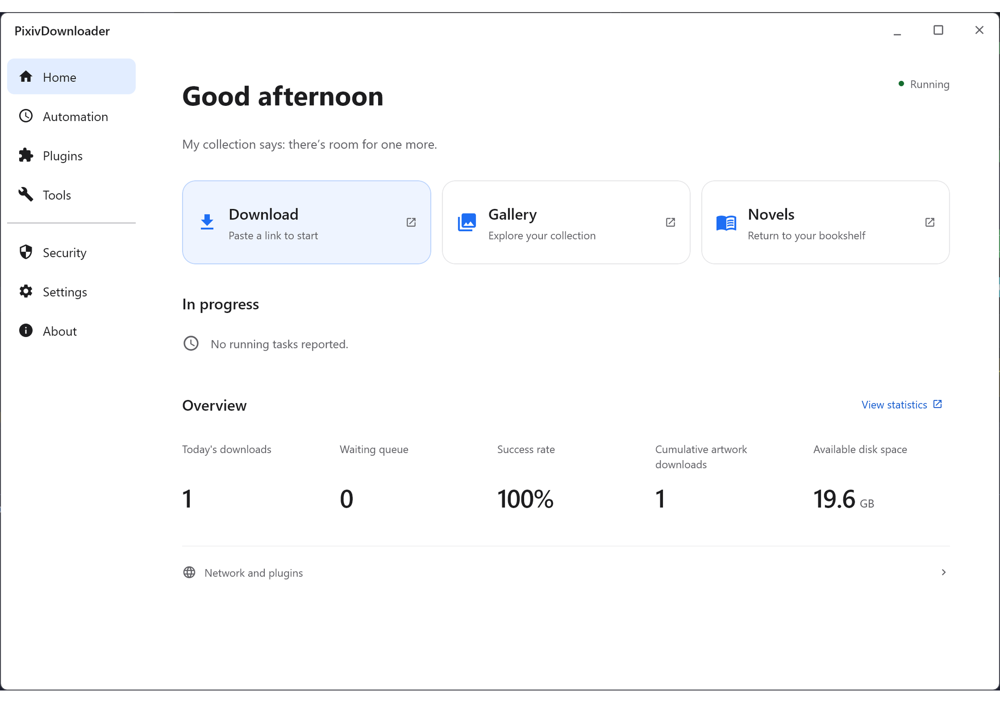

# PixivDownloader

[简体中文](./README.md) | [繁體中文](./README_zh-Hant.md) | 日本語 | [한국어](./README_ko.md) | [English](./README_en.md)

PixivDownloader は、Pixiv のイラスト、漫画、うごイラ、小説をローカル環境に一括保存し、ギャラリーで整理・閲覧するツールです。デスクトップ UI（Compose / Swing）、ブラウザーのダウンロード画面、Tampermonkey ユーザースクリプトから操作できます。

## 主な機能

- **多様な取得と一括ダウンロード**：[クイック取得](https://sywyar.github.io/PixivDownloader/#/ja/quick-access)（ブックマーク、投稿作品、リクエスト、フォロー新着、コレクション）、[URL 一括ダウンロード](https://sywyar.github.io/PixivDownloader/#/ja/batch-download)、[ユーザー一括ダウンロード](https://sywyar.github.io/PixivDownloader/#/ja/user-download)、[検索ダウンロード](https://sywyar.github.io/PixivDownloader/#/ja/search)、シリーズ一括取得、[Tampermonkey ユーザースクリプト](https://sywyar.github.io/PixivDownloader/#/ja/userscripts)に対応。
- **メディア変換と小説機能**：画像は元の形式・PNG・JPG・WebP、うごイラは WebP・GIF・APNG・MP4・元の ZIP を複数選択して保存可能。[小説](https://sywyar.github.io/PixivDownloader/#/ja/novel)は TXT / HTML / EPUB（シリーズ合本対応）での保存、本文全文検索、AI / Youdao / LibreTranslate 翻訳、AI 多役朗読に対応。
- **ローカルギャラリーと整理ツール**：[作品ギャラリー](https://sywyar.github.io/PixivDownloader/#/ja/gallery)と小説ギャラリーで、条件フィルター、3 状態のタグ/作者絞り込み、ローカルコレクション、一括 ZIP エクスポート、統計ダッシュボード、知覚ハッシュ（dHash）による類似画像検出、読み取り専用のゲスト招待リンクを提供。
- **スケジュールと通知**：[スケジュールタスク](https://sywyar.github.io/PixivDownloader/#/ja/scheduled-tasks)で一定間隔または 6 フィールド Cron による差分取得を実行し、認証切れ、過剰アクセス警告、連続失敗時にメールやプッシュで通知。
- **プラグイン機構と画面編集**：Compose / Swing デスクトップ UI、SQLite と任意の PostgreSQL データベース対応、[プラグイン管理・マーケット](https://sywyar.github.io/PixivDownloader/#/ja/plugin-management)、[ページエディター](https://sywyar.github.io/PixivDownloader/#/ja/page-editor)、[操作認証（CAPTCHA）](https://sywyar.github.io/PixivDownloader/#/ja/captcha)、[PixivBatchDownloader インポート](https://sywyar.github.io/PixivDownloader/#/ja/pixiv-batch-downloader-import)、公開 [サードパーティプラグイン SDK](https://sywyar.github.io/PixivDownloader/#/ja/plugin-development) を提供。

## スクリーンショット

> 一部の撮影端末では HDR が有効なため、色味が異なって見える場合があります。クリックすると静止画の一覧を開きます。

- [ライトモードのスクリーンショット](./readme/ja-JP/md/light-screenshot.md) · [ダークモードのスクリーンショット](./readme/ja-JP/md/dark-screenshot.md)

## クイックスタート

### 1. パッケージのダウンロード

[Releases](../../releases) から最新版を取得します。そのバージョンのリリースノートにある表を確認し、環境に合うパッケージを選んでください。

### 2. 起動と初期設定

[インストールと起動](https://sywyar.github.io/PixivDownloader/#/ja/installation)に沿ってアプリを起動し、[初回設定](https://sywyar.github.io/PixivDownloader/#/ja/first-setup)を完了してください。

## オンラインドキュメント

詳しい設定、データ移行、トラブルシューティング、開発手順は[オンラインドキュメント](https://sywyar.github.io/PixivDownloader/#/ja/)を参照してください。

- **クイックスタート**：[インストール](https://sywyar.github.io/PixivDownloader/#/ja/installation) · [初回セットアップ](https://sywyar.github.io/PixivDownloader/#/ja/first-setup) · [初回ダウンロード](https://sywyar.github.io/PixivDownloader/#/ja/first-download)
- **取得とダウンロード**：[クイック取得](https://sywyar.github.io/PixivDownloader/#/ja/quick-access) · [URL 一括ダウンロード](https://sywyar.github.io/PixivDownloader/#/ja/batch-download) · [ユーザー一括ダウンロード](https://sywyar.github.io/PixivDownloader/#/ja/user-download) · [検索ダウンロード](https://sywyar.github.io/PixivDownloader/#/ja/search) · [小説と朗読](https://sywyar.github.io/PixivDownloader/#/ja/novel) · [スケジュールタスク](https://sywyar.github.io/PixivDownloader/#/ja/scheduled-tasks) · [ユーザースクリプト](https://sywyar.github.io/PixivDownloader/#/ja/userscripts) · [外部ダウンロードのインポート](https://sywyar.github.io/PixivDownloader/#/ja/pixiv-batch-downloader-import)
- **管理とリファレンス**：[作品ギャラリー](https://sywyar.github.io/PixivDownloader/#/ja/gallery) · [設定リファレンス](https://sywyar.github.io/PixivDownloader/#/ja/configuration) · [ストレージとバックアップ](https://sywyar.github.io/PixivDownloader/#/ja/storage) · [操作リファレンス](https://sywyar.github.io/PixivDownloader/#/ja/usage-guide) · [ネットワークアクセス](https://sywyar.github.io/PixivDownloader/#/ja/network-access) · [よくある質問](https://sywyar.github.io/PixivDownloader/#/ja/faq)
- **プラグインと開発**：[プラグイン管理](https://sywyar.github.io/PixivDownloader/#/ja/plugin-management) · [ページエディター](https://sywyar.github.io/PixivDownloader/#/ja/page-editor) · [操作認証](https://sywyar.github.io/PixivDownloader/#/ja/captcha) · [サードパーティプラグイン SDK](https://sywyar.github.io/PixivDownloader/#/ja/plugin-development) · [本体開発ガイド](https://sywyar.github.io/PixivDownloader/#/ja/development) · [SDK Releases](https://github.com/Sywyar/PixivDownloader-Plugin-SDK/releases)

## ライセンス、関連ツール、免責事項

- **ライセンス**：本プロジェクトおよび公式プラグインは [AGPL-3.0](LICENSE) を採用しています。[プラグイン向けリンク例外](PLUGIN-LINKING-EXCEPTION.txt)の条件を満たす独立したサードパーティプラグインは MIT License 等を選択できます。
- **ブラウザー拡張機能との連携**：バックエンドを起動せずブラウザー単体で保存したい場合は [PixivBatchDownloader](https://github.com/xuejianxianzun/PixivBatchDownloader) を利用できます。本アプリの公式 [PixivBatchDownloader インポート](https://sywyar.github.io/PixivDownloader/#/ja/pixiv-batch-downloader-import) プラグインを使うと、保存済みファイルを移動せずローカルギャラリーへ自動登録できます。
- **免責事項**：本プロジェクトは個人の学習・研究目的専用であり、商用利用を禁じます。ダウンロードした作品の著作権は各権利者に帰属します。作品の再配布や商用利用はしないでください。本ツールは利用者が設定した Cookie で Pixiv にアクセスする非公式ツールです。適切なリクエスト間隔を設定し、自己責任で利用してください。
