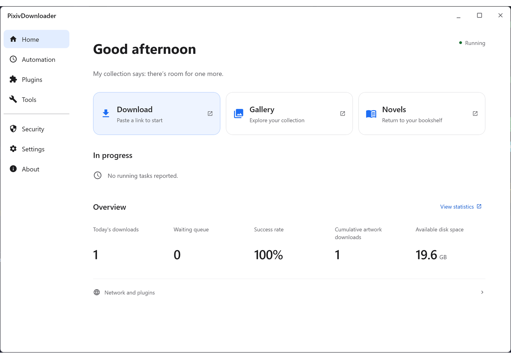

# PixivDownloader

[简体中文](./README.md) | [繁體中文](./README_zh-Hant.md) | [日本語](./README_ja.md) | 한국어 | [English](./README_en.md)

PixivDownloader는 Pixiv 일러스트, 만화, 우고이라(Ugoira), 소설을 로컬 컴퓨터나 서버에 일괄 다운로드하고 갤러리에서 관리하는 도구입니다. 데스크톱 UI(Compose / Swing), 브라우저 다운로드 작업대, Tampermonkey 사용자 스크립트를 지원합니다.

## 주요 기능

- **다양한 수집 및 일괄 다운로드**: [빠른 가져오기](https://sywyar.github.io/PixivDownloader/#/ko/quick-access)(북마크, 내 작품, 리퀘스트, 팔로우 신작, 컬렉션), [URL 일괄 다운로드](https://sywyar.github.io/PixivDownloader/#/ko/batch-download), [작가 일괄 다운로드](https://sywyar.github.io/PixivDownloader/#/ko/user-download), [검색 다운로드](https://sywyar.github.io/PixivDownloader/#/ko/search), 만화/소설 시리즈 다운로드 및 [Tampermonkey 사용자 스크립트](https://sywyar.github.io/PixivDownloader/#/ko/userscripts)를 지원합니다.
- **미디어 변환 및 소설 기능**: 이미지는 원본·PNG·JPG·WebP, 우고이라는 WebP·GIF·APNG·MP4·원본 ZIP 다중 선택 저장을 지원합니다. [소설](https://sywyar.github.io/PixivDownloader/#/ko/novel)은 TXT / HTML / EPUB(시리즈 합본 포함) 저장, 본문 전체 검색, AI / Youdao / LibreTranslate 번역 및 AI 다중 화자 낭독을 지원합니다.
- **로컬 갤러리 및 정리 도구**: [작품 갤러리](https://sywyar.github.io/PixivDownloader/#/ko/gallery)와 소설 갤러리에서 다중 조건 필터, 3상태 태그/작가 조합, 로컬 컬렉션, 일괄 ZIP 내보내기, 통계 대시보드, 지각 해시(dHash) 중복 이미지 감지 및 읽기 전용 게스트 초대 링크를 제공합니다.
- **예약 작업 및 알림**: [예약 작업](https://sywyar.github.io/PixivDownloader/#/ko/scheduled-tasks)으로 고정 주기 또는 6필드 Cron 일정에 따라 신작을 증분 다운로드하고, 인증 만료·과도한 접근 경고·연속 실패 시 이메일과 푸시 채널로 알림을 보냅니다.
- **플러그인 아키텍처 및 확장 UI**: Compose / Swing 데스크톱 UI, SQLite 및 선택적 PostgreSQL 데이터베이스, [플러그인 관리 및 마켓](https://sywyar.github.io/PixivDownloader/#/ko/plugin-management), [페이지 편집기](https://sywyar.github.io/PixivDownloader/#/ko/page-editor), [작업 인증(CAPTCHA)](https://sywyar.github.io/PixivDownloader/#/ko/captcha), [PixivBatchDownloader 가져오기 지원](https://sywyar.github.io/PixivDownloader/#/ko/pixiv-batch-downloader-import) 및 공개 [타사 플러그인 SDK](https://sywyar.github.io/PixivDownloader/#/ko/plugin-development)를 제공합니다.

## 화면 미리보기

> 일부 캡처 기기에서 HDR이 켜져 있어 색상이 다르게 보일 수 있습니다. 애니메이션을 클릭하면 전체 정적 스크린샷을 볼 수 있습니다.

- [라이트 모드 스크린샷](./readme/ko-KR/md/light-screenshot.md) · [다크 모드 스크린샷](./readme/ko-KR/md/dark-screenshot.md)

## 빠른 시작

### 1. 패키지 다운로드

[Releases](../../releases)에서 최신 버전을 다운로드하세요. 해당 버전의 릴리스 설명에 있는 표에서 환경에 맞는 패키지를 선택하세요.

### 2. 실행 및 초기 설정

[설치 및 실행](https://sywyar.github.io/PixivDownloader/#/ko/installation)에 따라 프로그램을 실행한 뒤 [최초 설정](https://sywyar.github.io/PixivDownloader/#/ko/first-setup)을 완료하세요.

## 온라인 문서

자세한 설정, 마이그레이션, 문제 해결 및 개발 안내는 [온라인 문서](https://sywyar.github.io/PixivDownloader/#/ko/)를 참고하세요:

- **빠른 시작**: [설치 및 실행](https://sywyar.github.io/PixivDownloader/#/ko/installation) · [최초 설정](https://sywyar.github.io/PixivDownloader/#/ko/first-setup) · [첫 다운로드](https://sywyar.github.io/PixivDownloader/#/ko/first-download)
- **수집 및 다운로드**: [빠른 가져오기](https://sywyar.github.io/PixivDownloader/#/ko/quick-access) · [URL 일괄 다운로드](https://sywyar.github.io/PixivDownloader/#/ko/batch-download) · [작가 일괄 다운로드](https://sywyar.github.io/PixivDownloader/#/ko/user-download) · [검색 다운로드](https://sywyar.github.io/PixivDownloader/#/ko/search) · [소설 다운로드](https://sywyar.github.io/PixivDownloader/#/ko/novel) · [예약 작업](https://sywyar.github.io/PixivDownloader/#/ko/scheduled-tasks) · [사용자 스크립트](https://sywyar.github.io/PixivDownloader/#/ko/userscripts) · [외부 다운로드 가져오기](https://sywyar.github.io/PixivDownloader/#/ko/pixiv-batch-downloader-import)
- **관리 및 참조**: [작품 갤러리](https://sywyar.github.io/PixivDownloader/#/ko/gallery) · [설정](https://sywyar.github.io/PixivDownloader/#/ko/configuration) · [저장 원칙](https://sywyar.github.io/PixivDownloader/#/ko/storage) · [고급 사용 안내](https://sywyar.github.io/PixivDownloader/#/ko/usage-guide) · [네트워크 액세스 및 타사 서비스](https://sywyar.github.io/PixivDownloader/#/ko/network-access) · [FAQ](https://sywyar.github.io/PixivDownloader/#/ko/faq)
- **플러그인 및 개발**: [플러그인 관리](https://sywyar.github.io/PixivDownloader/#/ko/plugin-management) · [페이지 편집기](https://sywyar.github.io/PixivDownloader/#/ko/page-editor) · [작업 인증](https://sywyar.github.io/PixivDownloader/#/ko/captcha) · [타사 플러그인 SDK](https://sywyar.github.io/PixivDownloader/#/ko/plugin-development) · [주 저장소 개발](https://sywyar.github.io/PixivDownloader/#/ko/development) · [SDK Releases](https://github.com/Sywyar/PixivDownloader-Plugin-SDK/releases)

## 라이선스, 관련 도구 및 면책 조항

- **라이선스**: 이 프로젝트와 공식 플러그인은 [AGPL-3.0](LICENSE)을 따르며, [플러그인 링크 예외](PLUGIN-LINKING-EXCEPTION.txt) 조건을 충족하는 독립 타사 플러그인은 MIT License 등을 선택할 수 있습니다.
- **브라우저 확장 연동**: 백엔드 없이 브라우저에서 직접 다운로드하려면 [PixivBatchDownloader](https://github.com/xuejianxianzun/PixivBatchDownloader)를 사용할 수 있습니다. 본 프로그램의 공식 [PixivBatchDownloader 가져오기 지원](https://sywyar.github.io/PixivDownloader/#/ko/pixiv-batch-downloader-import) 플러그인을 사용하면 다운로드한 원본 파일을 유지한 채 로컬 갤러리에 자동 등록할 수 있습니다.
- **면책 조항**: 이 프로젝트는 개인 학습 및 연구 목적으로만 제공되며 상업적 사용을 금지합니다. 다운로드한 콘텐츠의 저작권은 원작자에게 있습니다. 해당 콘텐츠를 재배포하거나 상업적으로 사용하지 마세요. 이 도구는 사용자가 직접 등록한 Cookie로 Pixiv에 접근하며 Pixiv 공식과 무관합니다. 적절한 다운로드 간격을 유지하고 계정 사용에 따른 책임을 유의하세요.
