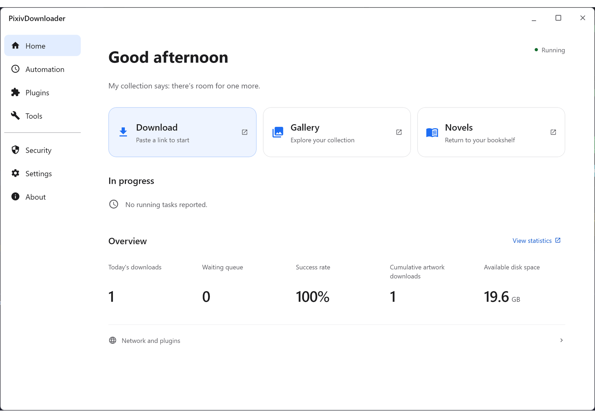

# PixivDownloader

[简体中文](./README.md) | 繁體中文 | [日本語](./README_ja.md) | [한국어](./README_ko.md) | [English](./README_en.md)

PixivDownloader 是本地執行的 Pixiv 插畫、漫畫、動圖（Ugoira）與小說批次下載及本地畫廊管理工具，提供桌面介面（Compose / Swing）、瀏覽器下載工作台與 Tampermonkey 使用者腳本。

## 核心功能

- **多方式取得與批次下載**：支援[快速取得](https://sywyar.github.io/PixivDownloader/#/zh-hant/quick-access)（收藏、投稿、約稿、關注新作、珍藏集）、[URL 批次匯入](https://sywyar.github.io/PixivDownloader/#/zh-hant/batch-download)、[畫師批次下載](https://sywyar.github.io/PixivDownloader/#/zh-hant/user-download)、[關鍵字搜尋下載](https://sywyar.github.io/PixivDownloader/#/zh-hant/search)、漫畫/小說系列下載與 [Tampermonkey 使用者腳本](https://sywyar.github.io/PixivDownloader/#/zh-hant/userscripts)。
- **媒體轉碼與小說功能**：圖片支援原始格式、PNG、JPG、WebP 多選儲存；動圖支援轉碼為 WebP、GIF、APNG、MP4 或保留原始 ZIP；[小說](https://sywyar.github.io/PixivDownloader/#/zh-hant/novel)支援儲存為 TXT / HTML / EPUB（含系列合訂本）、正文全文檢索、AI / 有道 / LibreTranslate 翻譯與 AI 多角色朗讀。
- **本地畫廊與整理工具**：[作品畫廊](https://sywyar.github.io/PixivDownloader/#/zh-hant/gallery)與小說畫廊支援多條件篩選、三態標籤/作者組合、本地收藏夾、批次 ZIP 匯出、統計儀表板、基於感知雜湊（dHash）的疑似重複檢測及唯讀訪客邀請碼。
- **排程工作與通知**：[排程工作](https://sywyar.github.io/PixivDownloader/#/zh-hant/scheduled-tasks)支援固定週期或 6 位 Cron 背景增量追更，遇到登入態失效、過度存取警告或連續失敗熔斷時透過郵件與多通道推送通知。
- **外掛化與可擴充介面**：預設提供 Compose 與 Swing 桌面介面、SQLite 與選用 PostgreSQL 資料庫支援、[外掛管理與市場](https://sywyar.github.io/PixivDownloader/#/zh-hant/plugin-management)、[頁面編輯器](https://sywyar.github.io/PixivDownloader/#/zh-hant/page-editor)、[操作驗證碼](https://sywyar.github.io/PixivDownloader/#/zh-hant/captcha)、[PixivBatchDownloader 匯入支援](https://sywyar.github.io/PixivDownloader/#/zh-hant/pixiv-batch-downloader-import)及公開 [第三方外掛 SDK](https://sywyar.github.io/PixivDownloader/#/zh-hant/plugin-development)。

## 介面預覽

> 部分截圖裝置啟用了 HDR，色彩效果可能略有差異；應用程式支援繁體中文介面（點擊動圖查看完整靜態截圖）。

- [淺色模式使用截圖](./readme/zh-Hant/md/light-screenshot.md) · [暗色模式使用截圖](./readme/zh-Hant/md/dark-screenshot.md)

## 快速開始

### 1. 下載發行套件

從 [Releases](../../releases) 下載最新版，依該版本發行說明中的表格選擇適合的套件。

### 2. 啟動與初始化

按照[安裝與啟動](https://sywyar.github.io/PixivDownloader/#/zh-hant/installation)執行程式，再依照[首次設定](https://sywyar.github.io/PixivDownloader/#/zh-hant/first-setup)完成初始化。

## 線上文件

完整設定、遷移、排障與開發參考請查閱[線上文件](https://sywyar.github.io/PixivDownloader/#/zh-hant/)：

- **開始使用**：[安裝與啟動](https://sywyar.github.io/PixivDownloader/#/zh-hant/installation) · [首次設定](https://sywyar.github.io/PixivDownloader/#/zh-hant/first-setup) · [第一次下載](https://sywyar.github.io/PixivDownloader/#/zh-hant/first-download)
- **取得與下載**：[快速取得](https://sywyar.github.io/PixivDownloader/#/zh-hant/quick-access) · [URL 批次下載](https://sywyar.github.io/PixivDownloader/#/zh-hant/batch-download) · [畫師批次下載](https://sywyar.github.io/PixivDownloader/#/zh-hant/user-download) · [搜尋下載](https://sywyar.github.io/PixivDownloader/#/zh-hant/search) · [小說與朗讀](https://sywyar.github.io/PixivDownloader/#/zh-hant/novel) · [排程工作](https://sywyar.github.io/PixivDownloader/#/zh-hant/scheduled-tasks) · [使用者腳本](https://sywyar.github.io/PixivDownloader/#/zh-hant/userscripts) · [匯入外部下載](https://sywyar.github.io/PixivDownloader/#/zh-hant/pixiv-batch-downloader-import)
- **管理與排障**：[作品畫廊](https://sywyar.github.io/PixivDownloader/#/zh-hant/gallery) · [設定參考](https://sywyar.github.io/PixivDownloader/#/zh-hant/configuration) · [儲存與備份](https://sywyar.github.io/PixivDownloader/#/zh-hant/storage) · [CLI 與進階參考](https://sywyar.github.io/PixivDownloader/#/zh-hant/usage-guide) · [網路存取與第三方服務](https://sywyar.github.io/PixivDownloader/#/zh-hant/network-access) · [常見問題](https://sywyar.github.io/PixivDownloader/#/zh-hant/faq)
- **外掛與開發**：[外掛管理](https://sywyar.github.io/PixivDownloader/#/zh-hant/plugin-management) · [頁面編輯器](https://sywyar.github.io/PixivDownloader/#/zh-hant/page-editor) · [操作驗證碼](https://sywyar.github.io/PixivDownloader/#/zh-hant/captcha) · [第三方外掛 SDK](https://sywyar.github.io/PixivDownloader/#/zh-hant/plugin-development) · [主儲存庫開發](https://sywyar.github.io/PixivDownloader/#/zh-hant/development) · [SDK Releases](https://github.com/Sywyar/PixivDownloader-Plugin-SDK/releases)

## 授權條款、相關工具與免責聲明

- **授權條款**：本專案及官方外掛採用 [AGPL-3.0](LICENSE)；符合[外掛連結例外](PLUGIN-LINKING-EXCEPTION.txt)條件的獨立第三方外掛可選用 MIT 等開放原始碼授權條款。
- **外部擴充功能整合**：若希望在瀏覽器內直接下載而不啟動本地後端，可使用 [PixivBatchDownloader](https://github.com/xuejianxianzun/PixivBatchDownloader)；本軟體提供官方 [PixivBatchDownloader 匯入支援](https://sywyar.github.io/PixivDownloader/#/zh-hant/pixiv-batch-downloader-import)，可將其下載的作品以唯讀參照方式自動登記到本地畫廊。
- **免責聲明**：本專案僅供個人學習與研究，請勿用於商業用途。下載作品的著作權歸原作者所有，請勿二次散佈或商業使用。本工具透過使用者自行提供的 Cookie 存取 Pixiv，與 Pixiv 官方無任何關聯；請合理控制下載間隔並自行承擔帳號使用風險。
